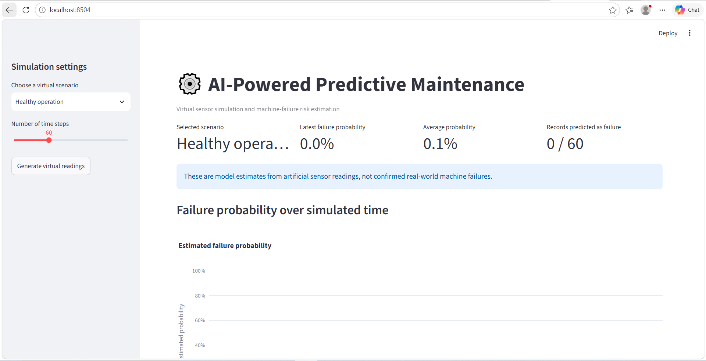
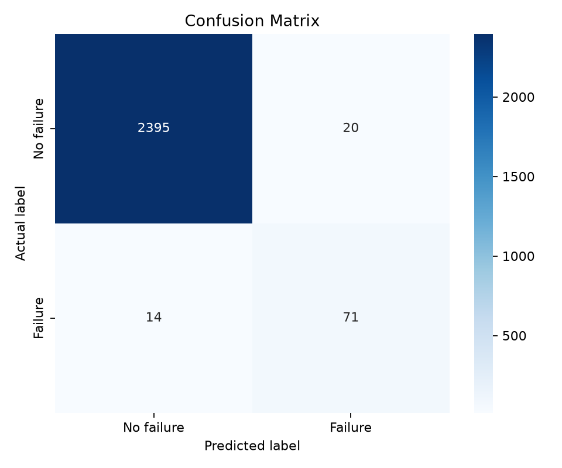

# AI-Powered Predictive Maintenance System for IoT Devices

A machine-learning project that estimates machine-failure risk from industrial operating measurements. The system uses the AI4I 2020 Predictive Maintenance Dataset, a virtual IoT sensor simulator, and a Streamlit dashboard to demonstrate predictive maintenance without physical IoT hardware.

## Project Overview

Unexpected machine failures can cause production delays, equipment damage, and maintenance costs. This project demonstrates how machine-learning techniques can analyze operating measurements and estimate the likelihood of a machine-failure label.

## Dashboard Preview



### Key Features

- Machine-failure classification using operating measurements
- Data preprocessing and feature engineering
- Model training and evaluation
- Predictions for new input records
- Virtual sensor simulation with multiple operating scenarios
- Interactive Streamlit dashboard
- Evaluation metrics, visualizations, and automated tests

## Technology Stack

- Python
- pandas and NumPy
- scikit-learn
- Streamlit
- Plotly
- Matplotlib and Seaborn
- Joblib
- pytest

## System Architecture

1. **Dataset:** Load the AI4I 2020 dataset.
2. **Preprocessing:** Validate the data and prepare model features.
3. **Model training:** Train a machine-learning classifier.
4. **Evaluation:** Review classification metrics and diagnostic plots.
5. **Prediction:** Estimate failure probability for new operating measurements.
6. **Virtual simulation:** Generate illustrative sensor readings for different scenarios.
7. **Dashboard:** Explore the simulated readings and model estimates interactively.

## Project Structure

```text
AI-Predictive-Maintenance-IoT/
├── app.py
├── main.py
├── requirements.txt
├── README.md
├── data/
│   ├── raw/
│   └── processed/
├── docs/
├── images/
├── models/
├── notebooks/
├── outputs/
│   ├── figures/
│   ├── metrics/
│   ├── predictions/
│   └── simulation/
├── src/
│   ├── data.py
│   ├── features.py
│   ├── predict.py
│   ├── simulator.py
│   └── train.py
└── tests/
    └── test_project.py
```

## Installation

### Prerequisites

- Python 3.12 recommended
- Git
- Visual Studio Code or another Python editor

Python 3.13 may also work if all project dependencies are compatible.

### 1. Clone the repository

```bash
git clone https://github.com/swetaastudies-droid/AI-Predictive-Maintenance-IoT.git
cd AI-Predictive-Maintenance-IoT
```

### 2. Create a virtual environment

**Windows PowerShell**

```powershell
py -3.12 -m venv .venv
```

Activate it:

```powershell
.\.venv\Scripts\Activate.ps1
```

If you use Python 3.13, replace `py -3.12` with `py -3.13`.

**macOS / Linux**

```bash
python3.12 -m venv .venv
source .venv/bin/activate
```

### 3. Install dependencies

Run these commands separately:

```bash
python -m pip install --upgrade pip
pip install -r requirements.txt
```

## Dataset

This project uses the **AI4I 2020 Predictive Maintenance Dataset** from the UCI Machine Learning Repository.

Dataset: https://archive.ics.uci.edu/dataset/601/ai4i+2020+predictive+maintenance+dataset

Download the dataset and place its CSV file at:

```text
data/raw/ai4i2020.csv
```

The expected source columns include:

- `Type`
- `Air temperature [K]`
- `Process temperature [K]`
- `Rotational speed [rpm]`
- `Torque [Nm]`
- `Tool wear [min]`
- `Machine failure`

The dataset represents synthetic industrial-style data, not live measurements from a real factory.

## Train and Evaluate the Model

From the project root, run:

```bash
python -m src.train
```

The training script generates the trained model and evaluation artifacts, including:

- `models/failure_model.joblib`
- `outputs/metrics/model_metrics.json`
- `outputs/metrics/classification_report.txt`
- `outputs/figures/confusion_matrix.png`
- `outputs/figures/feature_importance.png`
- `outputs/figures/failure_label_counts.png`

Exact outputs depend on the current implementation.

Because the dataset is imbalanced, evaluate precision, recall, F1-score, and the confusion matrix in addition to accuracy.

### Model Evaluation Results

The model was evaluated on a test set of 2,500 records from the AI4I 2020 Predictive Maintenance Dataset.

| Metric | No Failure | Failure |
|---|---:|---:|
| Precision | 0.99 | 0.78 |
| Recall | 0.99 | 0.84 |
| F1-score | 0.99 | 0.81 |
| Support | 2,415 | 85 |

**Overall accuracy:** 0.99 (99%)

The failure-class recall of 0.84 indicates that the model identified approximately 84% of the failure examples in this test set. The failure-class precision of 0.78 indicates that some failure predictions were false alarms.

Because the dataset is imbalanced, precision, recall, F1-score, and the confusion matrix are important when interpreting model performance. These results apply to the dataset test split and do not establish performance on real industrial equipment.

### Confusion Matrix

The confusion matrix summarizes correct and incorrect predictions for each class on the test set.



## Run Predictions on New Data

Prepare a CSV containing the six input columns required by the prediction script:

```text
Type
Air temperature [K]
Process temperature [K]
Rotational speed [rpm]
Torque [Nm]
Tool wear [min]
```

Run:

```bash
python -m src.predict path/to/new_readings.csv
```

Replace `path/to/new_readings.csv` with the path to your input file.

The predictions are written to `outputs/predictions/predictions.csv`, according to the current implementation.

## Run the Virtual IoT Simulation

After training the model, run:

```bash
python -m src.simulator
```

To choose the number of time steps per scenario:

```bash
python -m src.simulator --steps 100
```

The simulator generates illustrative scenarios such as:

- Healthy operation
- Gradual degradation
- Sudden stress

Simulation outputs include sensor readings, failure-probability trends, sensor visualizations, scenario comparisons, and a scenario summary under `outputs/simulation/`.

These scenarios are software-generated demonstrations, not actual hardware telemetry or verified real-world failure events.

## Launch the Streamlit Dashboard

After installing the dependencies and training the model, run:

```bash
streamlit run app.py
```

Streamlit should open the dashboard in your web browser. If it does not, use the local URL printed in the terminal.

The dashboard provides an interactive interface for exploring virtual sensor scenarios, operating measurements, and estimated failure probabilities.

If your dashboard uses a different startup command or requires additional files, follow the instructions for the current version of `app.py`.

## Run Tests

From the project root, run:

```bash
python -m pytest -q
```

Review the test results to confirm that the tested project components are working correctly.

## Limitations and Responsible Use

- The AI4I 2020 dataset is synthetic industrial-style data, not live factory telemetry.
- The model estimates the dataset's `Machine failure` label for an input row.
- It does not predict the exact time of failure or remaining useful life.
- A predicted probability is a model estimate, not a guarantee that a failure will occur.
- Simulated scenarios are illustrative and do not represent verified real-world breakdowns.
- This project is an educational demonstration and must not be used alone for safety-critical maintenance decisions.

## Future Improvements

- Connect real IoT sensor hardware or a streaming sensor platform.
- Evaluate the model on independent data from real equipment.
- Add time-series forecasting and remaining-useful-life estimation.
- Improve alert calibration and monitoring.
- Add model comparison, experiment tracking, and automated deployment.

## Author

Created as an educational machine-learning and predictive-maintenance project.

## License

No license has been specified yet. Contact the repository owner before reusing or redistributing this project's code.
